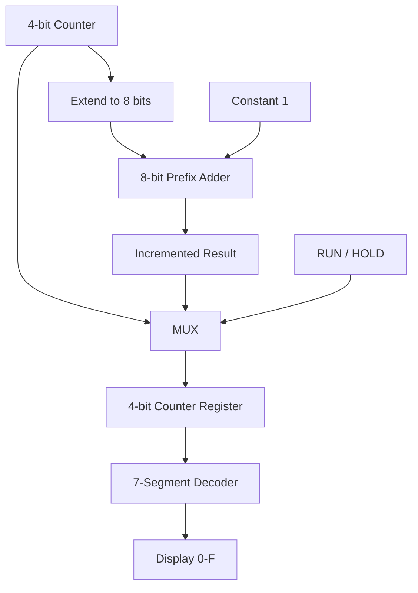
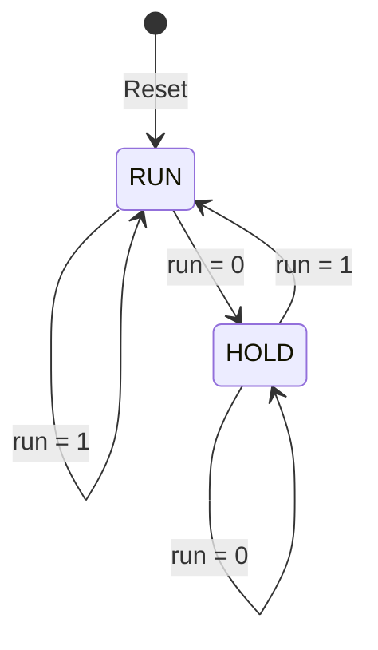

# Design and Implement 8-Bit Prefix Adder

## DLCD Level 2 Mini Project

This project focuses on designing and implementing an **8-bit prefix adder** using Verilog HDL and combining it with the Level 2 Problem 2 counter system: a **4-bit counter FSM with RUN/HOLD control and a common-cathode 7-segment output**.

## Project Overview

The 8-bit prefix adder performs binary addition using a prefix carry network. It will be tested independently with 8-bit operands and carry cases.

The integrated counter system has two control modes:

- **RUN:** increment the 4-bit counter on each active clock edge.
- **HOLD:** preserve the current counter value.

The counter counts from 0 to 15 and wraps to 0. A combinational 7-segment decoder displays the counter value in hexadecimal (0–F). The prefix adder is used in the increment path; the full 8-bit adder is also verified independently.

## Main Features

- 8-bit prefix adder with sum and carry-out
- RUN/HOLD control FSM
- 4-bit counter with synchronous active-high reset
- RUN/HOLD next-count selection
- Common-cathode, active-high 7-segment decoder
- Verilog testbenches for adder and integrated system
- Simulation and waveform inspection using Icarus Verilog and GTKWave

## Planned Modules

| Module | Responsibility |
|---|---|
| `prefix_adder_8bit` | Add two 8-bit operands using prefix carry logic |
| `run_hold_fsm` | Control RUN/HOLD operation |
| `counter_4bit` | Store and update the 4-bit count |
| `mux_4bit` | Select incremented count or held count |
| `seven_segment_decoder` | Decode hexadecimal count to segments |
| `top_module` | Connect the complete design |

Exact module names and segment bit ordering will be documented as implementation proceeds.

## Tools

- Verilog HDL
- Icarus Verilog
- GTKWave

## Verification Results

The full-system testbench completed successfully.

- **Prefix-adder exhaustive verification:** all **131,072** tested cases matched the expected result.
- **Reset:** count cleared to 0 and the display decoded 0.
- **RUN:** counter incremented correctly.
- **HOLD:** counter retained its current value (5 in the directed test).
- **RUN resume:** counter continued from the held value (6).
- **Hexadecimal sequence:** counter/display checks passed from 0 through F and wrapped back to 0.
- **Reset priority:** reset correctly took priority over RUN.
- **Final testbench status:** `ALL FULL-SYSTEM AND PREFIX-ADDER TESTS PASSED`.

## Verification Plan

1. Test the 8-bit prefix adder independently with representative inputs, carry propagation, and overflow.
2. Verify synchronous reset.
3. Verify RUN increments the counter.
4. Verify HOLD retains the count.
5. Verify RUN resumes from the held count.
6. Verify wraparound from 15 to 0.
7. Verify all hexadecimal decoder inputs (0–F).
8. Inspect actual VCD waveforms in GTKWave.

## Repository Progress

✅ **Implementation and verification completed** — the full-system testbench and exhaustive prefix-adder checks passed. GTKWave waveform screenshots are included below as project demonstration evidence.

## Project Issues

See the [Issues](../../issues) tab for module-level tasks and acceptance criteria.

## System Architecture

The 4-bit counter value is zero-extended to 8 bits and added to the 8-bit constant 1 by the prefix adder. The lower 4 bits of the incremented result are selected by the RUN/HOLD MUX and stored in the counter register. The register output is sent to the 7-segment decoder.

**Data path:** Current count → zero extension → prefix adder (+1) → RUN/HOLD MUX → counter register → 7-segment decoder → display.

## FSM State Diagram

## GTKWave Waveform Evidence

The following GTKWave screenshots are placed immediately after the System Architecture section for project presentation.

### Counter Waveform

Shows reset, RUN incrementing, HOLD retaining the current count, and counting resuming after RUN is enabled.

### Full-System Waveform

Shows the 8-bit prefix-adder inputs and output, clock, counter, expected values, FSM state, reset, RUN control, run enable, and seven-segment output. The trace demonstrates the counter sequence and corresponding display changes.

## Simulation and Waveform Verification

Run the repeatable Icarus Verilog simulation workflow in [GTKWave Waveform Verification](docs/gtkwave-waveform-verification.md). The GitHub Actions workflow uploads generated VCDs as an artifact named `verilog-waveforms`. Download the artifact from the completed Actions run and open `full_system.vcd` or `prefix_counter_top.vcd` in GTKWave.

**Simulation evidence:** [GitHub Actions run #4](https://github.com/nischalk987/Design-and-implement-8-bit-prefix-adder-/actions/runs/40185976272) completed successfully: the full-system suite passed, the prefix adder matched all 131,072 arithmetic combinations, the top-level testbench passed, and all 16 decoder patterns passed. The run uploaded the `verilog-waveforms` VCD artifact. See [GTKWave Waveform Verification](docs/gtkwave-waveform-verification.md) for signals and screenshot guidance. The generated VCD plot is a visualization of real simulator data, not a GTKWave GUI screenshot.

## 7-Segment Decoder K-Maps and Boolean Equations

This section records the 4-variable K-map values, minterms, and Boolean equations for the seven active-high outputs of the common-cathode hexadecimal decoder. Inputs are **A (MSB), B, C, D (LSB)**. K-map rows and columns use Gray-code order **00, 01, 11, 10**.

### K-map layout

| AB \\ CD | 00 | 01 | 11 | 10 |
|---|---:|---:|---:|---:|
| 00 | m0 | m1 | m3 | m2 |
| 01 | m4 | m5 | m7 | m6 |
| 11 | m12 | m13 | m15 | m14 |
| 10 | m8 | m9 | m11 | m10 |

### Segment a

| AB \\ CD | 00 | 01 | 11 | 10 |
|---|---:|---:|---:|---:|
| 00 | 1 | 0 | 1 | 1 |
| 01 | 0 | 1 | 1 | 1 |
| 11 | 1 | 0 | 1 | 1 |
| 10 | 1 | 1 | 1 | 1 |

Minterms: \(a=\Sigma m(0,2,3,5,6,7,8,9,10,12,13,14,15)\)

Boolean equation: \(a=C+AB'+AD'+B'D'+A'BD\)

### Segment b

| AB \\ CD | 00 | 01 | 11 | 10 |
|---|---:|---:|---:|---:|
| 00 | 1 | 1 | 1 | 1 |
| 01 | 1 | 0 | 1 | 0 |
| 11 | 1 | 0 | 0 | 0 |
| 10 | 1 | 1 | 1 | 1 |

Minterms: \(b=\Sigma m(0,1,2,3,4,7,8,9,10,13)\)

Boolean equation: \(b=B'+C'D'+A'CD\)

### Segment c

| AB \\ CD | 00 | 01 | 11 | 10 |
|---|---:|---:|---:|---:|
| 00 | 1 | 1 | 0 | 1 |
| 01 | 1 | 1 | 1 | 1 |
| 11 | 0 | 1 | 0 | 0 |
| 10 | 1 | 1 | 1 | 1 |

Minterms: \(c=\Sigma m(0,1,3,4,5,6,7,8,9,10,11,13)\)

Boolean equation: \(c=AB'+A'B+D'C'+A'D'\)

### Segment d

| AB \\ CD | 00 | 01 | 11 | 10 |
|---|---:|---:|---:|---:|
| 00 | 1 | 0 | 1 | 1 |
| 01 | 0 | 1 | 0 | 1 |
| 11 | 1 | 1 | 0 | 1 |
| 10 | 1 | 1 | 1 | 0 |

Minterms: \(d=\Sigma m(0,2,3,5,6,8,9,11,12,13,14)\)

Boolean equation: \(d=AC'+BC'D+BCD'+B'CD+A'B'D'\)

### Segment e

| AB \\ CD | 00 | 01 | 11 | 10 |
|---|---:|---:|---:|---:|
| 00 | 1 | 0 | 0 | 1 |
| 01 | 0 | 0 | 0 | 1 |
| 11 | 1 | 1 | 1 | 1 |
| 10 | 1 | 0 | 1 | 1 |

Minterms: \(e=\Sigma m(0,2,6,8,10,11,12,13,14,15)\)

Boolean equation: \(e=AB+AC+CD'+B'D'\)

### Segment f

| AB \\ CD | 00 | 01 | 11 | 10 |
|---|---:|---:|---:|---:|
| 00 | 1 | 0 | 0 | 0 |
| 01 | 1 | 1 | 0 | 1 |
| 11 | 1 | 0 | 1 | 1 |
| 10 | 1 | 1 | 1 | 1 |

Minterms: \(f=\Sigma m(0,4,5,6,8,9,10,11,12,14,15)\)

Boolean equation: \(f=AC+AB'+BD'+C'D'+A'BC'\)

### Segment g

| AB \\ CD | 00 | 01 | 11 | 10 |
|---|---:|---:|---:|---:|
| 00 | 0 | 0 | 1 | 1 |
| 01 | 1 | 1 | 0 | 1 |
| 11 | 0 | 1 | 1 | 1 |
| 10 | 1 | 1 | 1 | 1 |

Minterms: \(g=\Sigma m(2,3,4,5,6,8,9,10,11,13,14,15)\)

Boolean equation: \(g=AD+AB'+CB'+CD'+A'BC'\)

**K-map grouping note:** Groups must contain 1, 2, 4, or 8 adjacent cells and cover every ON minterm. Groups may overlap. Prime implicants are maximal valid groups; essential prime implicants cover at least one minterm not covered by any other prime implicant. Confirm the group selection and equations against the decoder truth table before treating this section as final.
